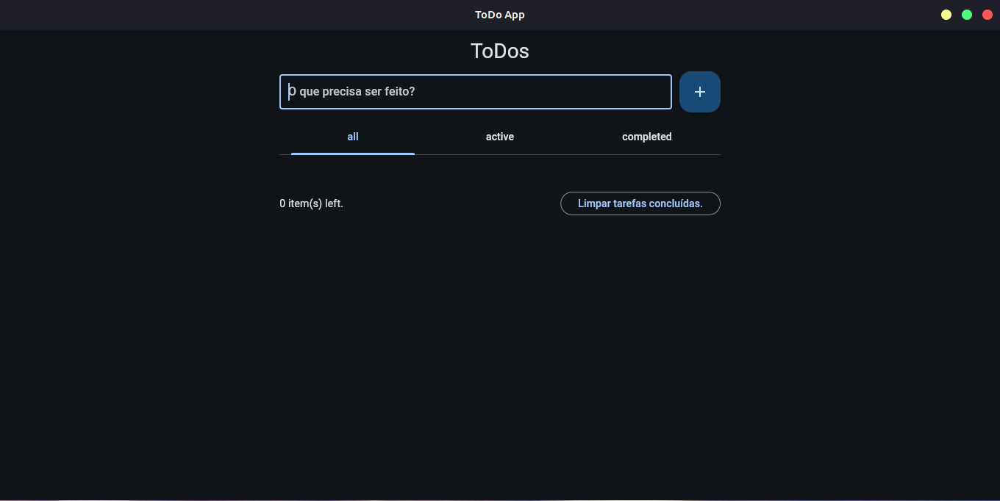
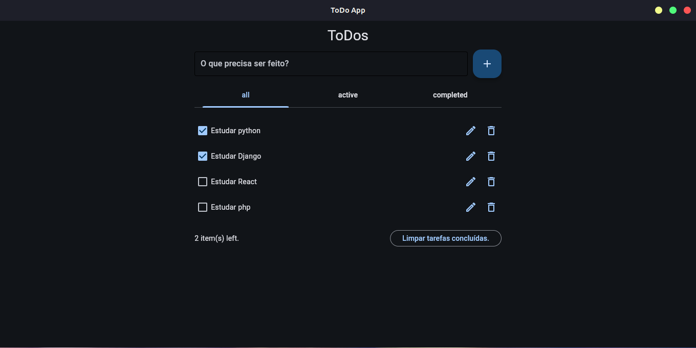
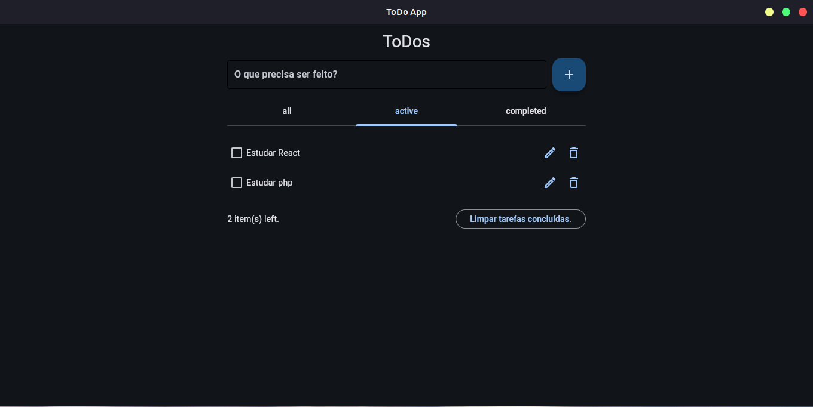
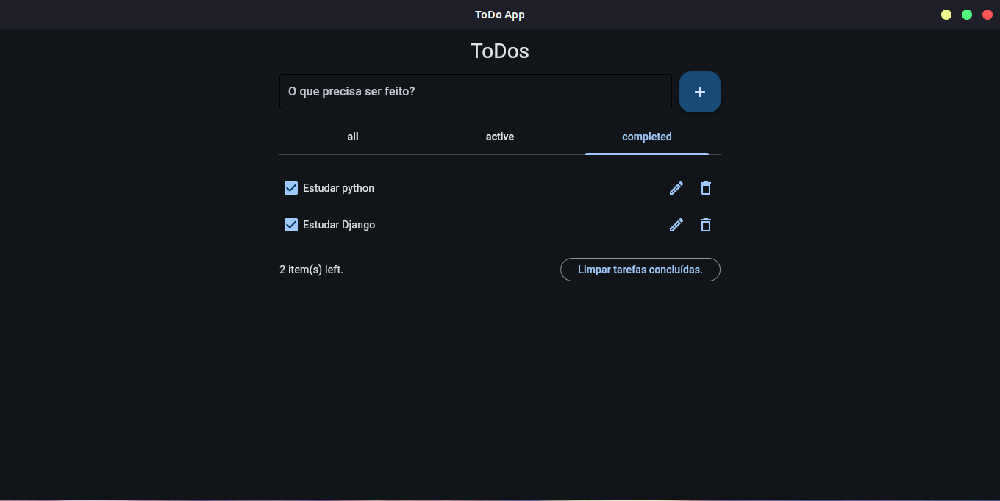

# Python Flet ToDo List

A simple and elegant ToDo List application built with Python and the Flet framework.

## 🚀 Technologies Used

- **Python**: The core programming language.
- **Flet**: A framework used to build interactive multi-platform apps in Python.

## 📁 Project Structure

Below is the project structure, excluding the `.github` directory:

```text
.
├── .gitignore
├── main.py
├── README.md
├── requirements.txt
├── task.py
└── todo_app.py
```

## 🛠️ How to Run the Project

Follow these steps to set up and run the project locally:

1. **Clone the repository:**

   ```bash
   git clone <repository-url>
   cd project-python-flet-todo-list
   ```

2. **Create a virtual environment (optional but recommended):**

   ```bash
   python -m venv .venv
   source .venv/bin/activate  # On Windows: .venv\Scripts\activate
   ```

3. **Install the dependencies:**

   ```bash
   pip install -r requirements.txt
   ```

4. **Execute the application:**

   ```bash
   python main.py
   ```

## 🖼️ Previews

Here are some screenshots of the application:





